# Диаграмма T-FLEX DOCs Open API: связи между классами

Источники: `TFlexDOCs API/1bec63ad-d601-41c8-978d-db7ee0e930d3.md` (диаграмма) и HTM-оригинал, где каждая линия диаграммы кликабельна и ведёт на страницу описания связи. Все пути файлов ниже — относительно корня документации и начинаются с каталога продукта `TFlexDOCs API`.

## Граф

```mermaid
graph TD
    classDef main fill:#90ee90,stroke:#333,stroke-width:2px;
    classDef sub fill:#e0ffe0,stroke:#333,stroke-width:1px;

    subgraph Connection [Соединение с сервером]
        ServerConnection[ServerConnection]:::main
        ReferenceCatalog[ReferenceCatalog]:::sub
        SystemReferences[SystemReferences]:::sub
        ClientView[ClientView]:::sub
        ConnectionParameters[ConnectionParameters]:::sub

        ServerConnection <-->|a178e6ad| ReferenceCatalog
        ServerConnection <-->|a20e51bb| SystemReferences
        ServerConnection <-->|b09e3287| ClientView
        ServerConnection -->|1207fd93| ConnectionParameters
    end

    subgraph Directory [Справочник]
        Reference[Reference]:::main
        ReferenceInfo[ReferenceInfo]:::sub
        ClassTree[ClassTree]:::sub
        ClassObjectCollection[ClassObjectCollection]:::sub
        ParameterGroup[ParameterGroup]:::sub
        ReferenceObjectCollection[ReferenceObjectCollection]:::sub

        ReferenceInfo -->|a9dd373a| Reference
        Reference <-->|3018e8d8| ClassTree
        Reference <-->|9ad7f692| ParameterGroup
        Reference <-->|80f7814f| ReferenceObjectCollection
        ClassTree -->|3bf87aa1| ClassObjectCollection
        ReferenceInfo <-->|652314c4| ClassTree
        ClassTree <-->|e660efaf| ParameterGroup
    end

    subgraph Filtering [Фильтрация объектов]
        Filter[Filter]:::main
        FilterTerm[FilterTerm]:::sub
        TermGroup[TermGroup]:::sub
        ReferenceObjectTerm[ReferenceObjectTerm]:::sub

        FilterTerm -->|8a34a935| Filter
        Filter <-->|1ebeb6c6| TermGroup
        TermGroup -->|be475885| ReferenceObjectTerm
    end

    subgraph Stages [Стадии]
        Stage[Stage]:::main
        SchemeStage[SchemeStage]:::sub
        Scheme[Scheme]:::sub

        SchemeStage -->|c3044ad0| Stage
        SchemeStage <-->|b0cbe9e8| Scheme
    end

    subgraph ObjectDir [Объект справочника]
        ReferenceObject[ReferenceObject]:::main
        Desktop[Desktop]:::sub
        ClassObject[ClassObject]:::sub
        ComplexHierarchyLink[ComplexHierarchyLink]:::sub

        Desktop -->|0a7ce272| ReferenceObject
        ReferenceObject <-->|c3aecb31| ClassObject
        ReferenceObject <-->|ab0d95a5| ComplexHierarchyLink
    end

    subgraph Signatures [Подписи]
        Signature[Signature]:::main
        SignatureType[SignatureType]:::sub
        SignatureTypes[SignatureTypes]:::sub
        SignatureCollection[SignatureCollection]:::sub

        Signature -->|c51f61b3| SignatureType
        Signature -->|d8bd2fad| SignatureTypes
        Signature <-->|d60136f3| SignatureCollection
        SignatureCollection -->|3b374408| SignatureTypes
        SignatureType <-->|66974794| SignatureTypes
    end

    subgraph Links [Связи объекта справочника]
        ReferenceObjectLinks[ReferenceObjectLinks]:::main
        AnyReferenceLink[AnyReferenceLink]:::sub
        OneToManyLink[OneToManyLink]:::sub
        OneToManyTable[OneToManyTable]:::sub
        OneToOneLink[OneToOneLink]:::sub

        ReferenceObjectLinks -->|a062acf8| AnyReferenceLink
        ReferenceObjectLinks -->|b5bd2d5f| OneToManyLink
        ReferenceObjectLinks -->|8fbcabbd| OneToManyTable
        ReferenceObjectLinks -->|1b0d24cb| OneToOneLink
    end

    %% Межблоковые связи
    ClassObject -->|37558b81| Stages
    ServerConnection <-->|9d97a031| Stage
    SystemReferences -->|8b07b937| Reference
    Directory <-->|728dff7d| Filter
    ParameterGroup -->|f0a9fafa| SignatureTypes
    ReferenceObject -->|22bbfb6f| SignatureCollection
    ReferenceCatalog <-->|d89a8975| ReferenceInfo
    Directory -->|ace889d9| Stages
    Directory <-->|0dda3b80| ObjectDir
    ComplexHierarchyLink -->|0e066e5a| ReferenceObjectLinks
    ReferenceObject -->|0f46c9f2| ReferenceObjectLinks
```

Подписи на рёбрах — первые 8 символов GUID файла описания связи (см. таблицу ниже).

## Связи внутри групп

### Группа «Соединение с сервером»

**ServerConnection ↔ ReferenceCatalog** (`TFlexDOCs API/a178e6ad-54b8-4652-bbae-245802977eea.md`)
- `ReferenceCatalog` — возвращает каталог справочников
- `Connection` — возвращает соединение с сервером приложения

**ServerConnection ↔ SystemReferences** (`TFlexDOCs API/a20e51bb-5715-43c6-9dc6-fab8f71ee8e3.md`)
- `References` — возвращает системные справочники
- `Connection` — возвращает соединение с сервером приложения

**ServerConnection ↔ ClientView** (`TFlexDOCs API/b09e3287-1b56-4661-bdbb-5eb868c3bdb5.md`)
- `ClientView` — возвращает рабочее место пользователя
- `Connection` — возвращает соединение с сервером приложения

**ServerConnection → ConnectionParameters** (`TFlexDOCs API/1207fd93-deb5-4276-9941-00d07443fff1.md`)
- `ConnectionParameters` — возвращает параметры текущего подключения

### Группа «Справочник»

**ReferenceInfo → Reference** (`TFlexDOCs API/a9dd373a-7e16-4a7c-9221-d5f11cc1a783.md`)
- `CreateReference` — создаёт экземпляр справочника для работы с данными

**Reference ↔ ClassTree** (`TFlexDOCs API/3018e8d8-9b29-48de-accb-6737e3731463.md`)
- `Classes` — возвращает дерево типов справочника

**Reference ↔ ParameterGroup** (`TFlexDOCs API/9ad7f692-988a-4601-8730-2b5ee69e1858.md`)
- `ParameterGroup` — возвращает основную группу параметров справочника

**Reference ↔ ReferenceObjectCollection** (`TFlexDOCs API/80f7814f-b773-4a13-9f4c-13ea44d0e91c.md`)
- `CreateLoader` — возвращает загрузчик коллекции объектов справочника, удовлетворяющих условиям фильтра, среди дочерних объектов указанного родительского объекта
- `Objects` — возвращает коллекцию объектов справочника на первом уровне иерархии
- `Reference` — возвращает справочник, для которого загружается коллекция объектов

**ClassTree → ClassObjectCollection** (`TFlexDOCs API/3bf87aa1-9146-4442-add2-19641b9ab6cf.md`)
- `AllClasses` — коллекция всех типов
- `BaseClasses` — коллекция базовых типов (типов, у которых нет базовых типов)
- `GetRootClasses` — типы, объекты которых можно создавать в корне справочника
- `GetRootBaseClasses` — базовые типы, объекты которых можно создавать в корне справочника
- `GetNotAbstractClasses` — типы, которые не являются абстрактными
- `GetFolderClasses` — типы, объекты которых могут содержать дочерние объекты
- `GetParameterGroupClasses` — типы, к которым подключена заданная группа параметров

**ReferenceInfo ↔ ClassTree** (`TFlexDOCs API/652314c4-5e0b-409b-8fa5-d9b5a0409f54.md`)
- `Classes` — возвращает дерево типов справочника (метод на ReferenceInfo)

**ClassTree ↔ ParameterGroup** (`TFlexDOCs API/e660efaf-afad-4c22-be8d-6a4ce0b9e3e8.md`)
- `Owner` — возвращает владельца дерева типов
- `Classes` — возвращает дерево типов текущей группы параметров

### Группа «Фильтрация объектов»

**FilterTerm → Filter** (`TFlexDOCs API/8a34a935-ee38-4a2a-b2a5-a13972646a26.md`)
- `Value` — возвращает значение в виде фильтра

**Filter ↔ TermGroup** (`TFlexDOCs API/1ebeb6c6-e10d-4823-a810-3ade36eb8a4f.md`)
- `Terms` — возвращает корневую группу условий фильтра (метод на Filter)
- `Filter` — возвращает фильтр, в который входит данная группа (свойство TermGroup)

**TermGroup → ReferenceObjectTerm** (`TFlexDOCs API/be475885-3c1f-4453-8451-9cf0a15c604a.md`)
- `AddTerm` — добавляет новое условие в группу (две перегрузки)

### Группа «Стадии»

**SchemeStage → Stage** (`TFlexDOCs API/c3044ad0-b024-4188-8050-6389c4ae53db.md`)
- `Stage` — возвращает стадию (свойство SchemeStage)

**SchemeStage ↔ Scheme** (`TFlexDOCs API/b0cbe9e8-d229-4dd5-a12c-67254aa61c63.md`)
- `AddStage` — подключает указанную стадию к текущей схеме (метод на Scheme)
- `Scheme` — возвращает схему (свойство SchemeStage)

### Группа «Объект справочника»

**Desktop → ReferenceObject** (`TFlexDOCs API/0a7ce272-7261-4a2b-8809-01d6ddf58482.md`)
- `CheckOutVersion` — делает актуальной указанную версию заданного объекта (метод на Desktop)

**ReferenceObject ↔ ClassObject** (`TFlexDOCs API/c3aecb31-9cb2-4597-ab0c-045ed590bf7f.md`)
- `Class` — возвращает тип объекта (свойство ReferenceObject)

**ReferenceObject ↔ ComplexHierarchyLink** (`TFlexDOCs API/ab0d95a5-98dd-4f9e-80af-c06f5d11423f.md`)
- На ReferenceObject: `GetParentLink`, `GetChildLink` — возвращают подключение объекта к родительскому/дочернему объекту; `CreateParentLink`, `CreateChildLink` — создают подключение; `MasterHierarchyLink` — подключение-владелец объекта
- На ComplexHierarchyLink: `ParentObject`, `ChildObject` — родительский/дочерний объект подключения; `SaveWith` — возвращает объект подключения, сохранённый с …

### Группа «Подписи»

**Signature → SignatureType** (`TFlexDOCs API/c51f61b3-11b6-4736-98f2-845e3126511f.md`)
- `SignatureObjectType` — возвращает тип подписи (свойство Signature)

**Signature → SignatureTypes** (`TFlexDOCs API/d8bd2fad-b178-4781-a5f6-30b2e900489d.md`)
- `SignatureTypeCollection` — возвращает коллекцию типов подписи (метод на Signature)

**Signature ↔ SignatureCollection** (`TFlexDOCs API/d60136f3-e32a-4593-bbba-935bafe3e955.md`)
- На Signature: `Signatures` — возвращает коллекцию подписей, в которую входит данная подпись
- На SignatureCollection: `Add` — добавляет подпись; `AddAndSign` — подписывает объект подписью указанного типа (две перегрузки: и от имени заданного пользователя)

**SignatureCollection → SignatureTypes** (`TFlexDOCs API/3b374408-58b3-47b3-93cf-5ec14f9003e9.md`)
- `Types` — возвращает коллекцию возможных типов подписи (метод на SignatureCollection)

**SignatureType ↔ SignatureTypes** (`TFlexDOCs API/66974794-999d-465e-b090-68294e5b17e7.md`)
- На SignatureType: `Types` — возвращает коллекцию типов подписи
- На SignatureTypes: `AddSignatureType` — добавляет новый тип подписи в коллекцию

### Группа «Связи объекта справочника»

**ReferenceObjectLinks → AnyReferenceLink** (`TFlexDOCs API/a062acf8-9a52-4e36-8058-2ef3698ee9ae.md`)
- `AnyReference` — возвращает менеджер связи с любым справочником (метод на ReferenceObjectLinks)

**ReferenceObjectLinks → OneToManyLink** (`TFlexDOCs API/b5bd2d5f-93e5-4e36-9fbc-7e1d6e890e06.md`)
- `FindToManyRelation` — возвращает для группы параметров отношение 1:N или N:N (учитывает обратные связи на тот же справочник); возвращаемый объект класса OneToManyRelation является базовым классом для OneToManyLink
- `ToMany` — возвращает менеджер отношений 1:N, N:N и для связей типа OneToManyTable
- `SwappedToMany` — возвращает менеджер обратных связей 1:N, N:N и для связей типа OneToManyTable

**ReferenceObjectLinks → OneToManyTable** (`TFlexDOCs API/8fbcabbd-c5a8-4cf1-95e0-751ca5d8d8ca.md`)
- `FindToManyRelation` — то же, что выше (OneToManyRelation — базовый класс для OneToManyTable)
- `ToMany` — менеджер отношений 1:N, N:N и для связей типа OneToManyTable
- `SwappedToMany` — менеджер обратных связей

**ReferenceObjectLinks → OneToOneLink** (`TFlexDOCs API/1b0d24cb-4ec3-4d2f-bb8b-f465b4f99cb2.md`)
- `FindToOneLink` — возвращает для группы параметров связь 1:1 или N:1 (учитывает обратные связи на тот же справочник)
- `ToOne` — возвращает менеджер связей 1:1 и N:1
- `SwappedToOne` — возвращает менеджер обратных связей 1:1 и N:1

## Связи между группами

**ReferenceCatalog ↔ ReferenceInfo** (`TFlexDOCs API/d89a8975-b6f0-4a5d-989d-1dec96ffdff4.md`)
На ReferenceCatalog: `Find(Guid)`, `Find(Int32)`, `Find(String)` — поиск описания справочника по GUID / ID / строковому названию, Guid или XmlId; `GetReferences` — список описаний всех справочников. На ReferenceInfo: `Catalog` — возвращает каталог справочников.

**SystemReferences → Reference** (`TFlexDOCs API/8b07b937-d43f-4318-a2c5-a085604087e4.md`)
Свойства SystemReferences, возвращающие системные справочники: `AssignmentFolders` («Папки поручений»), `Certificates` («Сертификаты»), `FileServers` («Разделы сервера файлов»), `GlobalParameters` («Глобальные параметры»), `Macros` («Макросы»), `NavigationPanel` («Панель навигации»), `Reports` («Отчёты»), `Units` («Единицы измерения»), `Users` («Группы и пользователи»), `WorkingAreas` («Папки»).

**ServerConnection ↔ Stage** (`TFlexDOCs API/9d97a031-0cd2-485d-9cb0-5c9e5e8da85a.md`)
- На ServerConnection: `Stages` — возвращает список всех стадий
- На Stage: `Connection` — возвращает соединение с сервером приложения

**Справочник ↔ Фильтрация (группа «Справочник» ↔ Filter)** (`TFlexDOCs API/728dff7d-fde4-408b-94ee-56d07c12031a.md`)
На Reference: `GetAccessFilter` — получить фильтр доступа. На Filter: `MainReference`, `SourceReference` — возвращают описание справочника; `MasterGroup` — возвращает группу параметров.

**Справочник → Стадии (группа «Справочник» ↔ группа «Стадии»)** (`TFlexDOCs API/ace889d9-c1da-4850-a508-421c5c94b602.md`)
На Reference: `Scheme` — возвращает схему переходов стадии; `DefaultStage` — возвращает стадию объектов по умолчанию.

**Справочник ↔ Объект справочника (группа «Справочник» ↔ группа «Объект справочника»)** (`TFlexDOCs API/0dda3b80-95df-4646-803b-b6e995be6a71.md`)
На Reference: `CreateReferenceObject`, `Find`, `FindOne`, `FindWithMaxCount` — создание и поиск объектов; `GetPrivateFolder` — личная папка текущего пользователя; `GetDeletedObjects` — объекты в корзине; `RecursiveLoad` — загрузка иерархии для заданных объектов; `CopyReferenceObject`, `CopyReferenceObjects` — копирование; `SetObjectsOrder` — установка порядка.
На ReferenceObject: `Reference` (два свойства с разными типами) — возвращает справочник.
На ClassObject: `ChildClasses`, `ChildObjectClasses`, `MasterObjectClasses`, `GetParentObjectClasses`, `GetAllChildClasses` — коллекции типов (дочерние, которые могут быть дочерними/владельцами/родительскими, все дочерние); `Find` — находит тип по наименованию.
На ClassTree: `Parents`, `Children`, `Versions` — коллекции родительских/дочерних/версионных объектов; `Parent` — родительский объект коллекции; `ItemInt32` — объект по индексу в коллекции; `Find` — поиск типа; `Classes` — дерево типов, к которому относится текущий тип.

**Справочник ↔ Подписи (ParameterGroup → SignatureTypes)** (`TFlexDOCs API/f0a9fafa-8004-46de-89e8-897fbd93a39a.md`)
- На ParameterGroup: `SignatureTypes` — возвращает типы используемых подписей

**Объект справочника ↔ Подписи (ReferenceObject → SignatureCollection)** (`TFlexDOCs API/22bbfb6f-489c-486a-a820-5bdb1ef281e3.md`)
- На ReferenceObject: `Signatures` — возвращает коллекцию подписей объекта
- На SignatureCollection: `Object` — возвращает объект справочника

**ClassObject → Стадии (ClassObject ↔ группа «Стадии»)** (`TFlexDOCs API/37558b81-d3a2-49a9-ad26-47e8a3ea989c.md`)
На ClassObject: `Scheme` — возвращает схему переходов стадии; `DefaultStage` — возвращает стадию объектов по умолчанию.

**Объект справочника → Связи объекта (ReferenceObject → ReferenceObjectLinks)** (`TFlexDOCs API/0f46c9f2-ee44-4371-b162-14ed02fc46a7.md`)
- На ReferenceObject: `Links` — возвращает связи объекта. ReferenceObject является наследником класса DesktopObject и получает от него свойство Links.

**Объект справочника → Связи объекта (ComplexHierarchyLink → ReferenceObjectLinks)** (`TFlexDOCs API/0e066e5a-0387-4fb5-bf99-6608e8cd93b8.md`)
- На ComplexHierarchyLink: `Links` — возвращает связи объекта. ComplexHierarchyLink является наследником класса DesktopObject и получает от него свойство Links.

> Примечание: в оригинальном HTM на диаграмме две отдельные линии ведут на одну и ту же страницу описания (`0f46c9f2...md`) — для ReferenceObject и для ComplexHierarchyLink; выше они разведены по заголовкам страницы.
